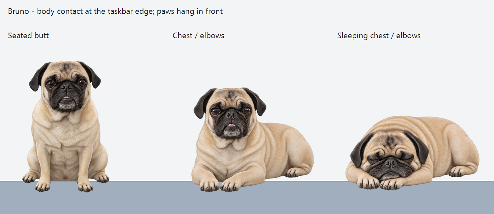

# Meet Bruno

Bruno is a little pug who hangs out on your Windows desktop. He sits, lies down,
gets sleepy, and occasionally tilts his head or sticks out his tongue.

## Install Bruno

For Windows 10 or 11.

1. [Download the Bruno installer](https://github.com/BurtFablehoff/Bruno/releases/download/v0.1.2/Bruno-Setup-0.1.2.exe).
2. If your browser says the file isn't commonly downloaded, click **Keep**, then **Keep anyway** when it asks again.
3. Open **Bruno-Setup-0.1.2.exe** from your Downloads folder.
4. If Windows shows **Windows protected your PC**, click **More info**, then **Run anyway**.
5. Follow the setup steps, click **Install**, then **Finish**. Bruno will appear on your desktop!

Already have Bruno open? Click him and choose **Close** before installing the new version.

## Using Bruno

- **Click Bruno** to open his menu. You can change his size or ask him to sit or lie down.
- **Hold the left mouse button and drag** to move him.
- Choose **Start with Windows** if you'd like him to appear when you turn on your computer.
- Choose **Close** when you want him to leave.

Bruno will get sleepy and change poses on his own.

