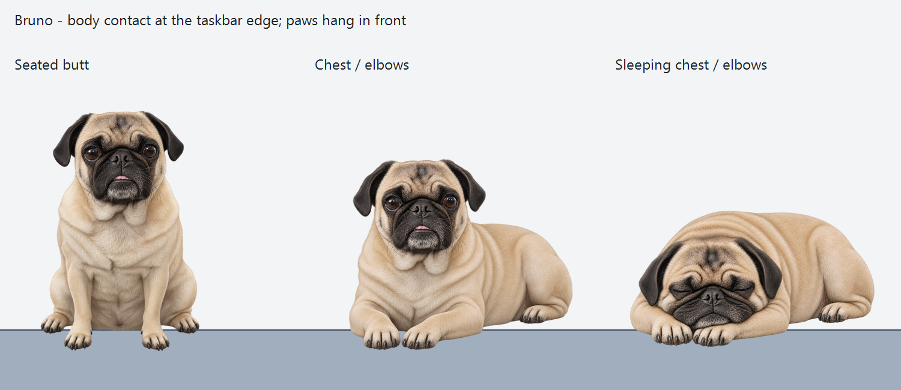

# Bruno 0.1.2

Bruno the pug is a quiet Windows desktop companion with sitting, lying and
head-down sleeping poses. Blinks, head tilts and tongue peeks stay within the
current awake pose. Sleep and pose changes happen automatically.

## Downloads

- **Bruno-Setup-0.1.2.exe**: per-user Windows installer, Start-menu shortcut,
  optional desktop shortcut and uninstaller. No administrator rights required.
- **Bruno.exe**: portable companion; keep it in a writable folder and run it.
- **SHA256SUMS.txt**: verification hashes for both files.

Requires Windows 10/11 x64. Quit an older Bruno before launching the new version.

## Highlights

- Small, Normal, Large and Extra Large sizes, with a smaller default for new settings.
- Seated butt and lying chest/elbows rest on the taskbar edge; front paws hang over.
- Click visible fur to open the menu, left-drag to reposition, and click outside
  the menu to dismiss it. Size and screen controls are available from the menu.
- Windows startup is opt-in. Automatic updating is disabled in this first release;
  use GitHub Releases for future downloads.

## Validation

Both production and developer builds passed embedded-art integrity checks,
840 placements, nine posture routes, 48 awake-action cases, 96 simulated hours,
menu/gesture checks, eight body hit regions and 206 hidden native uploads.
The hanging-paw hit targets were checked below the floor line. The installer
archive and exact production payload were verified without installing it.
Artwork, animations and the corrected body contact passed owner review.

