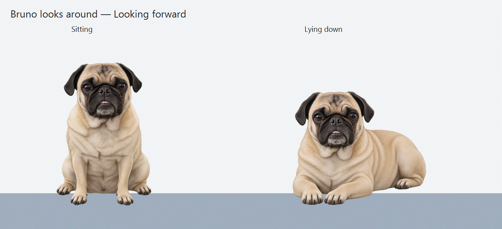

# Bruno 0.1.5

Bruno now follows your mouse while sitting or lying down, with twelve look directions in each pose. Choose **Look at mouse** in his menu to turn this on or off.

His size, resting position on the taskbar, and existing expressions stay the same.

## Update Bruno

If you have Bruno 0.1.4, click him and choose **Check for updates**. Turn on **Automatic updates** if you want him to get future releases automatically.

If you have 0.1.3 or earlier, install this version once using the steps below. Those older versions cannot update themselves.

## Install Bruno

For Windows 10 or 11.

1. [Download the Bruno installer](https://github.com/BurtFablehoff/Bruno/releases/download/v0.1.5/Bruno-Setup-0.1.5.exe).
2. If your browser asks, click **Keep**, then **Keep anyway** when it asks again.
3. Close the old Bruno if he is running, then open **Bruno-Setup-0.1.5.exe**.
4. If Windows shows **Windows protected your PC**, click **More info**, then **Run anyway**.
5. Click **Install**, then **Finish**.

